<div align = center>

# [Arduino-Utils](https://github.com/ArminJo/Arduino-Utils)
My utility collection for Arduino<br/>
Fast and flexible ADC conversions, voltage and resistance measurement, RAM, heap and stack info, hex dumps, EMA filters and more.

[](https://www.gnu.org/licenses/gpl-3.0)
 &nbsp; &nbsp;
[](https://github.com/ArminJo/Arduino-Utils/releases/latest)
 &nbsp; &nbsp;
[](https://github.com/ArminJo/Arduino-Utils/commits/master)
 &nbsp; &nbsp;
[](https://github.com/ArminJo/Arduino-Utils/actions)
 &nbsp; &nbsp;

<br/>
<br/>
[](https://stand-with-ukraine.pp.ua)

[](https://github.com/ArminJo/Arduino-Utils/archive/refs/heads/master.zip)
 &nbsp; &nbsp;
[](https://github.com/ArminJo/Arduino-Utils?tab=readme-ov-file#revision-history)

</div>

#### If you find this library useful, please give it a star.

&#x1F30E; [Google Translate](https://translate.google.com/translate?sl=en&u=https://github.com/ArminJo/Arduino-Utils)

<br/>

# Table of contents
* [Installation and usage](https://github.com/ArminJo/Arduino-Utils?tab=readme-ov-file#installation-and-usage)
* [Overview](https://github.com/ArminJo/Arduino-Utils?tab=readme-ov-file#overview)
* [SimpleEMAFilters](https://github.com/ArminJo/Arduino-Utils?tab=readme-ov-file#simpleemafilters)
* [ADCUtils](https://github.com/ArminJo/Arduino-Utils?tab=readme-ov-file#adcutils)
* [MeasureVoltageAndResistance](https://github.com/ArminJo/Arduino-Utils?tab=readme-ov-file#measurevoltageandresistance)
* [HCSR04](https://github.com/ArminJo/Arduino-Utils?tab=readme-ov-file#hcsr04)
* [AVRUtils](https://github.com/ArminJo/Arduino-Utils?tab=readme-ov-file#avrutils)
* [HexDump](https://github.com/ArminJo/Arduino-Utils?tab=readme-ov-file#hexdump)
* [ShowInfo](https://github.com/ArminJo/Arduino-Utils?tab=readme-ov-file#showinfo)
* [MillisUtils](https://github.com/ArminJo/Arduino-Utils?tab=readme-ov-file#millisutils)
* [ToneUtils](https://github.com/ArminJo/Arduino-Utils?tab=readme-ov-file#toneutils)
* [ATtinyUtils](https://github.com/ArminJo/Arduino-Utils?tab=readme-ov-file#attinyutils)
* [BlinkLed](https://github.com/ArminJo/Arduino-Utils?tab=readme-ov-file#blinkled)
* [Small helpers](https://github.com/ArminJo/Arduino-Utils?tab=readme-ov-file#small-helpers)
* [DebugLevel](https://github.com/ArminJo/Arduino-Utils?tab=readme-ov-file#debuglevel)
* [Optiboot 8.1](https://github.com/ArminJo/Arduino-Utils?tab=readme-ov-file#optiboot-81)
* [Utilities available as separate Arduino library](https://github.com/ArminJo/Arduino-Utils?tab=readme-ov-file#utilities-available-as-separate-arduino-library)
* [Compile options and IDE hints](https://github.com/ArminJo/Arduino-Utils?tab=readme-ov-file#compile-options-and-ide-hints)
* [Examples](https://github.com/ArminJo/Arduino-Utils?tab=readme-ov-file#examples)
* [Revision History](https://github.com/ArminJo/Arduino-Utils?tab=readme-ov-file#revision-history)
* [CI](https://github.com/ArminJo/Arduino-Utils?tab=readme-ov-file#ci)

<br/>

# Installation and usage
This library is **not yet available in the Arduino Library Manager**.<br/>
Download the [ZIP file](https://github.com/ArminJo/Arduino-Utils/archive/refs/heads/master.zip) and install it with *Sketch > Include Library > Add .ZIP Library...* in the Arduino IDE.

Most utilities are AVR specific (Uno, Nano, Leonardo, Mega, ATtiny85, ATtiny167 etc.).

### .h and .hpp files
Some utilities are provided as **`.hpp` files**, which contain the complete implementation.
- Include the `.hpp` file **only once**, i.e. in your main `.ino` or `.cpp` file. Otherwise you will get "multiple definition" linker errors.
- In all other files include the corresponding `.h` file, if one exists.
- Compile options (macros like `USE_LCD`) must be defined **before** the `#include` of the `.hpp` file.

```c++
#include "ADCUtils.hpp"    // In the main file only
```
```c++
#include "ADCUtils.h"      // In all other files
```

<br/>

# Overview

| File | Content |
|-|-|
| [SimpleEMAFilters.hpp](https://github.com/ArminJo/Arduino-Utils/blob/master/src/SimpleEMAFilters.hpp) | Ultra fast EMA lowpass, highpass, bandpass and biquad filters with Arduino Plotter output. |
| [ADCUtils.hpp](https://github.com/ArminJo/Arduino-Utils/blob/master/src/ADCUtils.hpp) | Fast ADC conversions, oversampling, VCC and CPU temperature measurement, undervoltage checks. |
| [MeasureVoltageAndResistance.hpp](https://github.com/ArminJo/Arduino-Utils/blob/master/src/MeasureVoltageAndResistance.hpp) | Volt- and ohmmeter with 1 mV and 2 &ohm; resolution. |
| [HCSR04.hpp](https://github.com/ArminJo/Arduino-Utils/blob/master/src/HCSR04.hpp) | Blocking and non-blocking reading of HC-SR04 ultrasonic distance sensors. |
| [BlinkLed.h](https://github.com/ArminJo/Arduino-Utils/blob/master/src/BlinkLed.h) | Class for non-blocking blinking of one or more LEDs. |
| [AVRUtils.h](https://github.com/ArminJo/Arduino-Utils/blob/master/src/AVRUtils.h) | Sleep with watchdog, RAM, heap and stack info. |
| [HexDump.hpp](https://github.com/ArminJo/Arduino-Utils/blob/master/src/HexDump.hpp) | Hex and ASCII memory and stack dumps. |
| [ShowInfo.h](https://github.com/ArminJo/Arduino-Utils/blob/master/src/ShowInfo.h) | Prints timer, peripheral and system registers, fuses and BOD level. |
| [MillisUtils.h](https://github.com/ArminJo/Arduino-Utils/blob/master/src/MillisUtils.h) | Stop, start and compensate the `millis()` timer, non-blocking delay helpers. |
| [ToneUtils.hpp](https://github.com/ArminJo/Arduino-Utils/blob/master/src/ToneUtils.hpp) | Very small `tone()` replacement for pin 3 and 11 of ATmega328. |
| [ATtinyUtils.h](https://github.com/ArminJo/Arduino-Utils/blob/master/src/ATtinyUtils.h) | Tone, timer, fuse and clock functions for ATtiny85 and ATtiny167. |
| [LCDPrintUtils.hpp](https://github.com/ArminJo/Arduino-Utils/blob/master/src/LCDPrintUtils.hpp) | Print helpers for parallel and I2C character LCDs. |
| [WireUtils.hpp](https://github.com/ArminJo/Arduino-Utils/blob/master/src/WireUtils.hpp) | I2C read / write helpers, error printing and I2C bus scan. |
| [PrintUtils.hpp](https://github.com/ArminJo/Arduino-Utils/blob/master/src/PrintUtils.hpp) | `PrintIfChanged` class, which prints a value only if it has changed. |
| [LongUnion.h](https://github.com/ArminJo/Arduino-Utils/blob/master/src/LongUnion.h) | Unions for easy access to the bytes and words of 16, 32 and 64 bit values. |
| [DebugLevel.h](https://github.com/ArminJo/Arduino-Utils/blob/master/src/DebugLevel.h) | Debug levels TRACE, DEBUG, INFO, WARN and ERROR. |
| [digitalWriteFast.h](https://github.com/ArminJo/Arduino-Utils/blob/master/src/digitalWriteFast.h) | Fast `digitalWrite()`, `digitalRead()` and `pinMode()` for constant pin numbers. |

<br/>

# SimpleEMAFilters
An EMA (**Exponential Moving Average**) filter behaves like an RC lowpass filter with RC = SamplePeriod * ((1 - alpha) / alpha),
see [here](https://en.wikipedia.org/wiki/Low-pass_filter#Simple_infinite_impulse_response_filter).<br/>
It can be implemented by a single statement:

```c++
int16_t sLowpass3;
int16_t sLowpass5;
...
sLowpass3 += ((aInputValue - sLowpass3) + (1 << 2)) >> 3; // 1.8 us, alpha = 1/8 = 0.125,    cutoff frequency 22.7 Hz @1kHz
sLowpass5 += ((aInputValue - sLowpass5) + (1 << 4)) >> 5; // 2.5 us, alpha = 1/32 = 0.03125, cutoff frequency 5.13 Hz @1kHz
```
This takes only **2.5 &micro;s on a 16 MHz Arduino Uno**.

The implemented **ultra fast EMA filters** use alpha values of 1/2, 1/4, 1/8, 1/16, 1/32 and 1/256, corresponding to shift values of 1, 2, 3, 4, 5 and 8.

### Cutoff (-3 dB) frequencies for a 1 kHz sampling rate
The simplified formula for small alpha is: CutoffFrequency = SampleFrequency / (2&pi; * ((1 / alpha) - 1))

The more exact formula is alpha = 1 - e<sup>-(2&pi; * CutoffFrequency / SampleFrequency)</sup>,
which gives CutoffFrequency = (-ln(1 - alpha) * SampleFrequency) / 2&pi;
(see [this spreadsheet](https://github.com/MakeMagazinDE/DigitaleFilter/blob/main/Filter-Berechnungen.xlsx)).

| Alpha | Shift | Simplified formula | Exact formula |
|-|-|-|-|
| 1/2 | >> 1 | 160 Hz | 110 Hz |
| 1/4 | >> 2 | 53 Hz (= 160 Hz / 3) | 46 Hz |
| 1/8 | >> 3 | 22.7 Hz (= 160 Hz / 7) | 21.2 Hz |
| 1/16 | >> 4 | 10.6 Hz (= 160 Hz / 15) | 10.3 Hz |
| 1/32 | >> 5 | 5.13 Hz (= 160 Hz / 31) | 5.05 Hz |
| 1/64 | >> 6 | 2.54 Hz (= 160 Hz / 63) | |
| 1/128 | >> 7 | 1.26 Hz (= 160 Hz / 127) | |
| 1/256 | >> 8 | 0.624 Hz (= 160 Hz / 255) | |

The **maximum output value of the integer filters** is InputValue - ((1 << (ShiftValue - 1)) - 1),
i.e. **85 for an InputValue of 100 and ShiftValue 5** (Lowpass5).

### [SimpleEMAFilters.hpp](https://github.com/ArminJo/Arduino-Utils/blob/master/src/SimpleEMAFilters.hpp) contains
- A set of **ultra fast** EMA filters, which require only **1 to 2 microseconds**.
- Highpass and bandpass filters, generated by subtracting a lowpass from the input (highpass) or from another lowpass (bandpass).
- 16 and 32 bit biquad filters / State Variable Filters (SVF).
- Output routines for the Arduino Plotter.

`doFiltersStep(int16_t aInputValue)` applies all implemented filters at once to the input value.
The results can then be displayed in the Arduino Plotter with `printFiltersResults()`.

### Generic functions or inline code
There are generic functions for EMA filters, but it is normally faster to write the filter inline:

```c++
int16_t Lowpass3;
int16_t Lowpass5;
int32_t Lowpass5_int32;
int32_t Lowpass8_int32;
...
Lowpass3 += ((InputValue - Lowpass3) + (1 << 2)) >> 3; // 2.0 us, alpha = 0.125, cutoff frequency 22.7 Hz @1kHz
Lowpass5 += ((InputValue - Lowpass5) + (1 << 4)) >> 5; // 2.6 us, alpha = 1/32 0.03125, cutoff frequency 5.13 Hz @1kHz
Lowpass5_int32 += ((((int32_t) InputValue) << 8) - Lowpass5_int32) >> 5;   // Fixed point 4.0 us, value is Lowpass5_int32 >> 8
Lowpass8_int32 += ((((int32_t) InputValue) << 16) - Lowpass8_int32) >> 8;  // Fixed point 2.13 us because of fast 8 bit shift, value is Lowpass8_int32 >> 16
```

The floating point implementation of the 1/32 EMA filter takes **20 to 34 &micro;s**.

> [!IMPORTANT]
> The 16 bit implementations are limited to a **maximum input value of +/- 16383** for a rectangular input (the worst case),
> because the term `InputValue - Lowpass3` must always fit into a 16 bit signed integer.

### Arduino Plotter outputs
The outputs are generated by the [EMAFilterDemo](https://github.com/ArminJo/Arduino-Utils/tree/master/examples/EMAFilterDemo) example.
They show a 42, 21, 10.5 and 5.2 Hz signal at a sample rate of 1 ms (or 84, 42 ... Hz at a sample rate of 0.5 ms and so on).
In the captions, e.g. *LowP3* is the lowpass implemented by `>> 3`, i.e. alpha = 1/8 with a cutoff frequency of 21 Hz.

#### Rectangle input with an amplitude of +/- 100
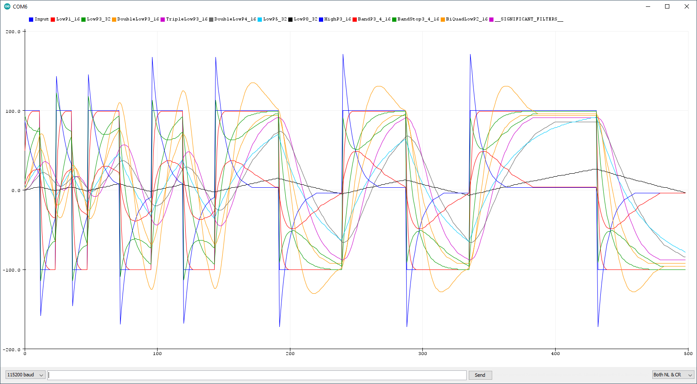

Note:
- A highpass is always input - lowpass. Therefore a highpass (here HighP3_16) can have an overshoot of up to 100 %.
- A bandstop is always input - bandpass.
- The higher the frequency, the more the output of DoubleLowpass3 and 4 resembles a delayed sine.
- LowP5_32 and DoubleLowP4_16 have almost the same amplitude, but DoubleLowP4_16 is much more like a (delayed) sine.
- TripleLowP3_16 has a higher amplitude than DoubleLowP4_16, and both look quite like a (delayed) sine.
- Lowpass8 behaves like an integrator here and gives a triangle output, because its cutoff frequency is very low.
- The BiQuad filter tends to oscillate at its resonance frequency.

#### Rectangle input with a very low amplitude of +/- 20
Here you see clipping effects due to the limited resolution of 16 bit math.
Lowpass3_int32 and Lowpass5_int32 are 32 bit fixed point implementations with a higher resolution.
They require **3.06 / 3.94 &micro;s instead of 2.0 / 2.63 &micro;s for 16 bit**.

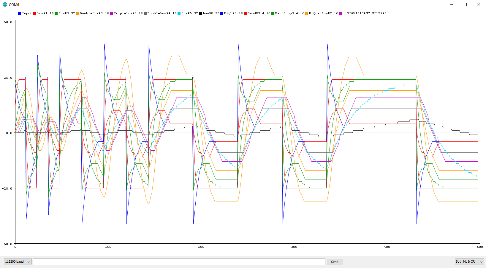

#### Sine input with an amplitude of +/- 100
Note the **different attenuation** at different frequencies and the **different phase shifts** of the filters.

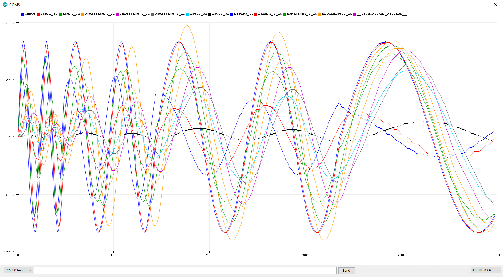

#### Triangle input with an amplitude of +/- 100
Higher order filters and lowpass filters with high shift values / low cutoff frequencies give an almost perfect sine.

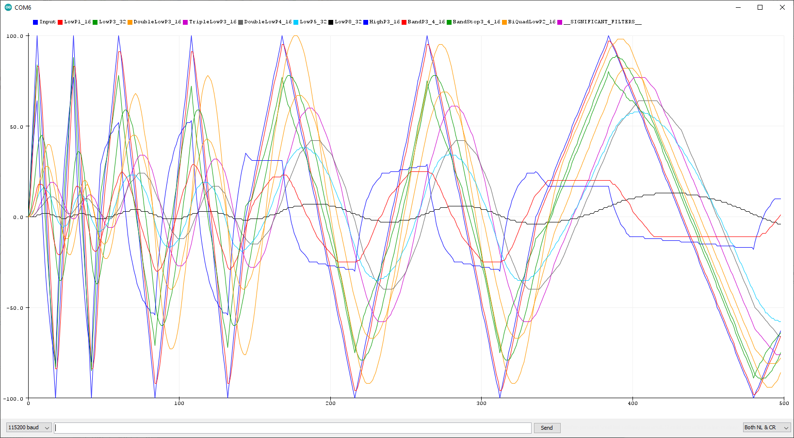

#### Sawtooth input with an amplitude of +/- 100
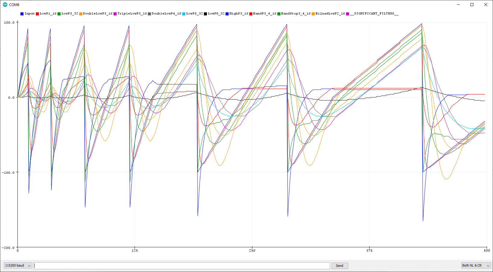

#### BiQuad filters
BiQuad filters / State Variable Filters (SVF) with no damping (factor = 1) and a damping factor of 1/4.
You can see the oscillation at the resonance frequency.

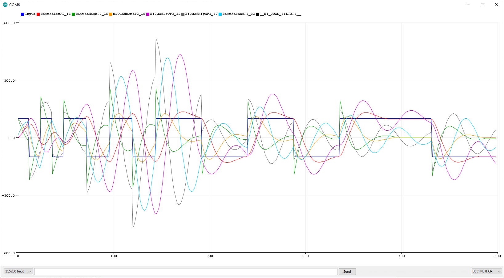

#### Random input with an amplitude of +/- 100
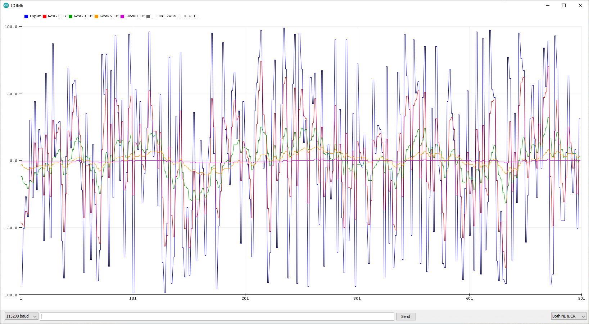

#### Rectangle input with 4 different frequencies 42 Hz > 21 Hz > 10.5 Hz > 5.2 Hz
Click on the pictures to enlarge them.

| All lowpass filters | Highpass filters<br/>Generated by subtracting a lowpass from the input. |
| :-: | :-: |
| 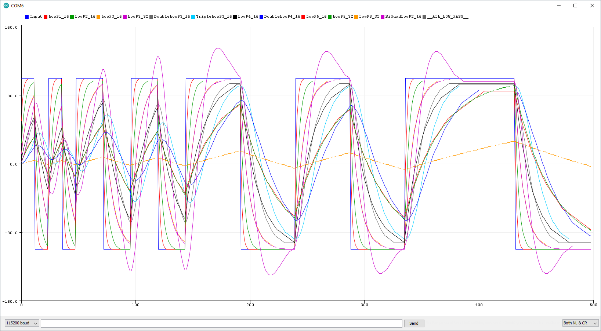 | 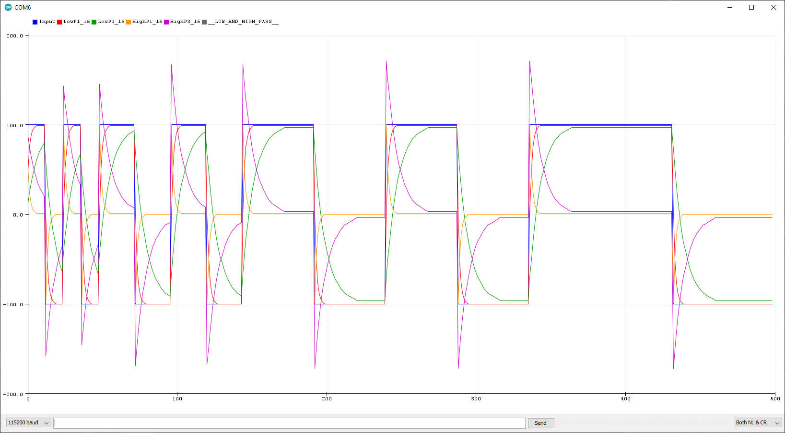 |
| **Bandpass and bandstop filters**<br/>A bandpass is generated by subtracting one lowpass from another with a different shift value.<br/>A bandstop is input minus bandpass. | **Selected lowpass filters**<br/>Lowpass8 behaves like an integrator here and gives a triangle output. |
| 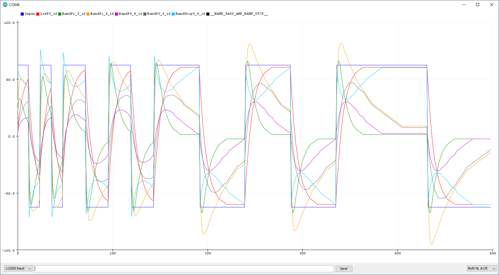 | 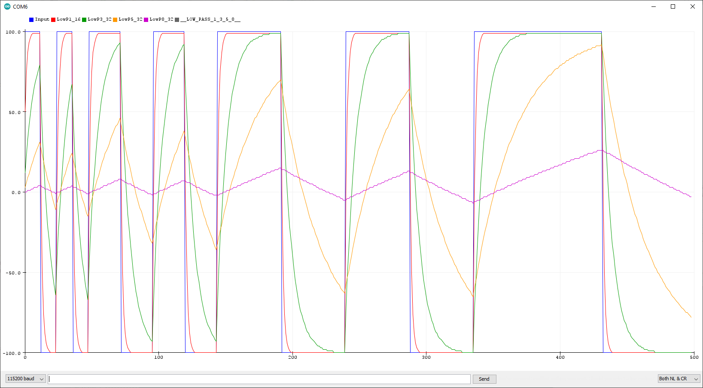 |
| **LowPass3, 5 and 8**<br/>Comparison of implementations with 16 bit integer, 32 bit integer and 32 bit float. | |
| 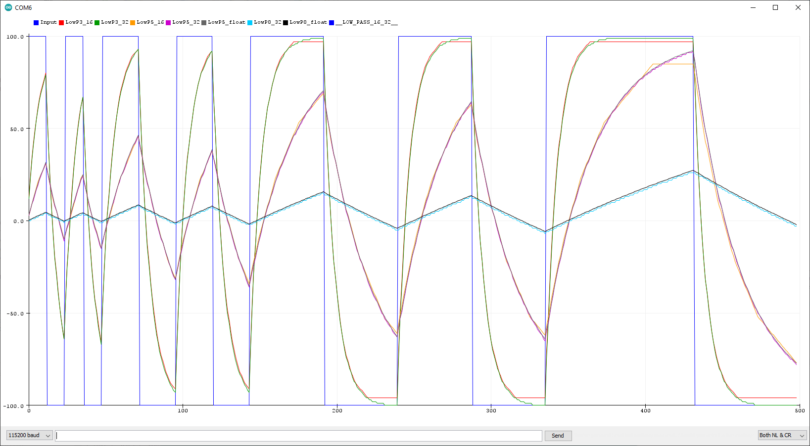 | |

### Related links
- https://en.wikipedia.org/wiki/Moving_average#Exponential_moving_average
- https://www.dsprelated.com/blogimages/RickLyons/Exponential_Averaging_FIGURE2.gif
- https://www.norwegiancreations.com/2015/10/tutorial-potentiometers-with-arduino-and-filtering/
- https://www.norwegiancreations.com/2016/08/double-exponential-moving-average-filter-speeding-up-the-ema/
- https://www.norwegiancreations.com/2016/03/arduino-tutorial-simple-high-pass-band-pass-and-band-stop-filtering/
- https://arduinokickstompdrum.wordpress.com/2021/05/14/simple-filtering/
- https://github.com/popcornell/Arduino-Multiplierless-EMA-filter
- https://github.com/MakeMagazinDE/DigitaleFilter

<br/>

# ADCUtils
Fast and flexible ADC conversions with **intelligent handling of the delays required after switching reference or channel**.
- Functions for easy **oversampling**, e.g. `readADCChannelWithOversample()`.
- Functions to get the maximum of many measurements, e.g. `readADCChannelWithReferenceMax()`.
- Functions to get the **VCC voltage and the CPU temperature**, e.g. `getVCCVoltageMillivolt()`, `getCPUTemperature()`.
  The VCC resolution is only 20 millivolt!
- Functions to check whether VCC is too low for a given period, e.g. `isVCCUndervoltageMultipleTimes()`. Useful for Li-ion battery supply.
- Function to detect USB supply, `isVCCUSBPowered()`.

The `*Simple()` functions are smaller and faster, but do not handle reference or channel switching.
Use them only if you call no other ADC function in your program.

The CPU temperature is not available for ATmega32U4, ATmega644, ATmega1284 and ATmega2560.

<br/>

# MeasureVoltageAndResistance
Measures voltage and resistance with **1 mV and 2 &ohm; resolution** at the lower end.<br/>
First the voltage is measured. If the voltage is zero, the unknown resistance to ground is measured using the 5 volt (VCC) supply
and a series resistor of 10 k&ohm; or 100 k&ohm;.<br/>
The results can be shown on Serial and on a 1602 or 2004 LCD.

See the [VoltAndOhmmeter](https://github.com/ArminJo/Arduino-Utils/tree/master/examples/VoltAndOhmmeter) example.

### Fritzing board
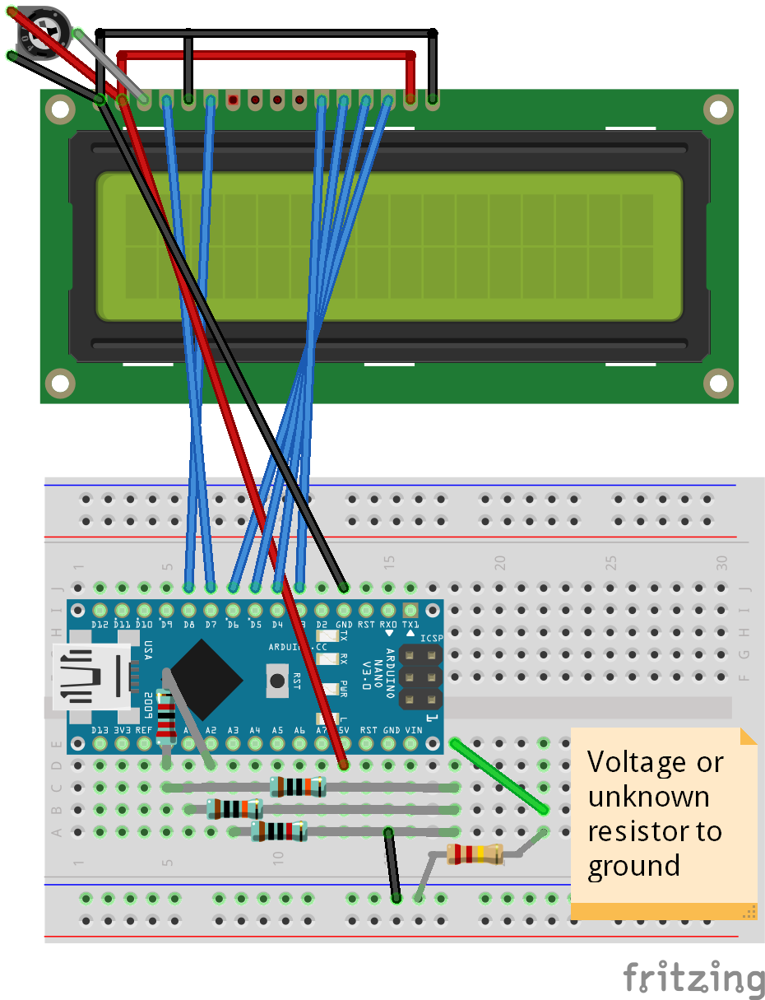
### Fritzing schematics
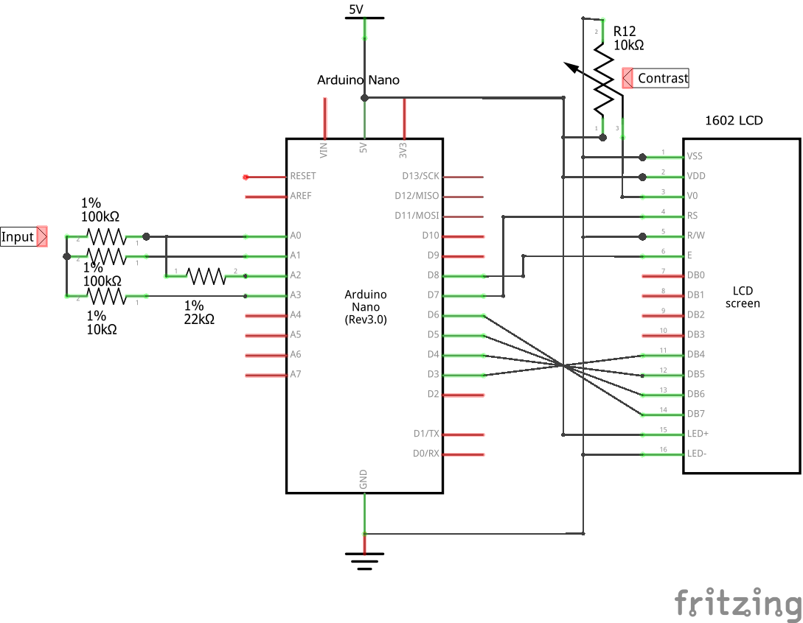

<br/>

# HCSR04
- Blocking and **non-blocking** reading of HC-SR04 ultrasonic sensors with timeouts and exact conversions.
- Also supports the **1 pin mode** of the HY-SRF05 or Parallax PING modules.
- The non-blocking functions `startUSDistanceAsCentimeterWithCentimeterTimeoutNonBlocking()` and `isUSDistanceMeasureFinished()`
  require one of the macros `USE_PIN_CHANGE_INTERRUPT_D0_TO_D7`, `USE_PIN_CHANGE_INTERRUPT_D8_TO_D13` or `USE_PIN_CHANGE_INTERRUPT_A0_TO_A5`.

```c++
#include "HCSR04.hpp"

void setup() {
    initUSDistancePins(TRIGGER_OUT_PIN, ECHO_IN_PIN);
}
void loop() {
    unsigned int tCentimeter = getUSDistanceAsCentimeter(); // 0 means timeout
}
```

### Modifying HC-SR04 modules for 1 pin mode
| Module | Modification |
|-|-|
| Old module with 3 16 pin chips | Connect Trigger and Echo directly or with a resistor < 4.7 k&ohm;.<br/>If you remove both 10 k&ohm; pullup resistors, you can use a resistor < 47 k&ohm;, but 10 k&ohm; is more reliable. |
| Old module with 3 16 pin chips, but without pullup resistors near the connector row | Connect Trigger and Echo with a resistor > 200 &ohm;. Use 10 k&ohm;. |
| New module with 1 16 pin and 2 8 pin chips | Connect Trigger and Echo with a resistor > 200 &ohm; and < 22 k&ohm;. |
| **All modules** | **Connect Trigger and Echo with a resistor of 4.7 k&ohm;.** |

See also [another Arduino HC-SR04 library](https://github.com/Martinsos/arduino-lib-hc-sr04).

<br/>

# AVRUtils
- Sleep with watchdog, e.g. `sleepWithWatchdog(WDTO_1S, true)`, with optional correction of `millis()`.
- Computation and display of available RAM, heap and stack, e.g. `printRAMAndStackInfo(&Serial)`.
- Measurement of the maximum used stack, `initStackFreeMeasurement()` and `printStackMaxUsedAndUnusedSizes(&Serial)`.
- Display of the watchdog reset reason in [AVRUtilsDemo](https://github.com/ArminJo/Arduino-Utils/tree/master/examples/AVRUtilsDemo).
  This currently (3/2024) only works with the [Optiboot 8.1 bootloader](https://github.com/ArminJo/Arduino-Utils/tree/master/Optiboot_8_1).

The RAM starts with the variables initialized with values != 0, followed by the variables initialized with 0
and the variables not initialized, using the attribute `__attribute__((section(".noinit")))`. It ends with the heap and the stack.

#### Sample output if the stack runs into the data
```
Size of Data + BSS, Heap start, Stack end=2041
Stack used 20 of 7
Currently available Heap=0
```

<br/>

# HexDump
Creates hex memory and stack dumps on the serial output.

```c++
void printBufferHex(uint8_t *aBufferAddress, uint16_t aNumberOfBytesToPrint);              // No address, hex bytes without ASCII representation
void printBufferHexDump(uint8_t *aBufferAddress, uint16_t aNumberOfBytesToPrint);          // Short relative address, hex bytes without ASCII representation
void printBufferHexAndASCIIDump(uint8_t *aBufferAddress, uint16_t aNumberOfBytesToPrint);  // Short relative address, hex bytes with ASCII representation
void printMemoryHexNoASCIIDump(uint8_t *aMemoryAddress, uint16_t aNumberOfBytesToPrint);   // 16 bit address, hex bytes without ASCII representation
void printMemoryHexAndASCIIDump(uint8_t *aMemoryAddress, uint16_t aNumberOfBytesToPrint);  // 16 bit address, hex bytes with ASCII representation
void printStackMemory(uint16_t aNumberOfBytesToPrint); // 16 bit address and hex bytes, ending at top of stack / RAM end
void printStackDump();                                 // 16 bit address and hex bytes, from current stack pointer to top of stack / RAM end
```

#### Sample output
```
0x0000:  0xFF 0x81 0x82 0x00 0x08 0x02 0x00 0x27 0xFF 0xFF 0x0E 0xB3 0x81 0xFC 0x9B 0x47   .. .. '  .....G
0x0010:  0x00 0x00 0x00 0x00 0x20 0x65 0x00 0x0F 0xBE 0xEB 0x9B 0x98 0x2C 0xF1 0x08 0x2C       e .....,..,
0x0020:  0x55 0x55 0x55 0x55 0x55 0x55 0x55 0x55 0x55 0x55 0x55 0x55 0x55 0x55 0x55 0x55  UUUUUUUUUUUUUUUU
```

See also [another Arduino dump library](https://github.com/neu-rah/Dump).

<br/>

# ShowInfo
- Serial output of timer, other peripheral and system registers, e.g. `TimerRegisterDump()`.
- Output of the reset reason, `printMCUSR()`, and of the BOD level, `printBODLevel()`.
- Output of all fuses with description for ATtiny85, `printFuses()`.

<br/>

# MillisUtils
Unifies `millis()` timer handling for Digispark, ATTinyCore and Arduino cores.
- Stop and start the `millis()` timer interrupt, `disableMillisInterrupt()` and `enableMillisInterrupt()`.
- Compensate `millis()` after long running tasks in `noInterrupts()` context like NeoPixel output, ADC buffer reading etc., `addToMillis()`.
- Blocking `delayMilliseconds()` function for use in `noInterrupts()` context like an ISR.
- Non-blocking replacement for `delay()`, `areMillisGone()`.
- Measure the duration of a function call, `speedTestWith1kCalls()`.

<br/>

# ToneUtils
Lightweight implementation of the Arduino `tone(Pin, Frequency)` function on pin 3 and 11 for ATmega328 (Uno, Nano etc.),
`toneSimpleAtPin3()`, `toneSimpleAtPin11()` and `noToneSimpleAtPin3Or11()`.
- Requires only **80 bytes of program memory** instead of **1500 bytes** for Arduino `tone()`.
- Requires no interrupts.
- Restricted to prescaler 32 to 256, therefore supporting only frequencies **from 122 Hz to 250 kHz**.

<br/>

# ATtinyUtils
For ATtiny25/45/85 and ATtiny87/167.
- `toneWithTimer1PWM()` and `noToneWithTimer1PWM()` generate a signal and its inverted signal, to drive a buzzer between 2 pins with double volume.
- `periodicInterruptWithTimer1()`.
- `isBODSFlagExistent()` checks for ATtiny85 revision C.
- Fuse reading functions, `getBODLevelFuses()` and `isBODLevelBelow2_7VoltOrDisabled()`.
- Fast port B functions, e.g. `digitalWriteFastPortB()` and `toggleFastPortB()`.
- `changeDigisparkClock()` to use Digispark boards with another core, like the [ATTinyCore](https://github.com/SpenceKonde/ATTinyCore) by Spence Konde.
  It changes the clock settings of the Digispark bootloader to get the right CPU frequency and resets the Digispark OSCCAL tweak.
  Consider using the new [optimized Digispark core](https://github.com/ArminJo/DigistumpArduino) instead.

<br/>

# BlinkLed
Class for blinking one or more LEDs independently and non-blocking. You must call `update()` continuously in `loop()`.

```c++
#include "BlinkLed.h"
BlinkLed RedLed(LED_BUILTIN);

void setup() {
    RedLed.start(3, 1000);      // Blink 3 times with a period of 1000 ms
}
void loop() {
    RedLed.update();
}
```
- A blink count of `0` / `BLINK_LED_COUNT_FOREVER` means blinking forever, until `stop()` or `off()` is called.
- `blinkBlocking(BlinkCount, ...)` and the function `blinkLEDBlocking(LEDPin, BlinkCount,...)` are simple blocking variants.

<br/>


# Small helpers
- [LCDPrintUtils.hpp](https://github.com/ArminJo/Arduino-Utils/blob/master/src/LCDPrintUtils.hpp) - For `LiquidCrystal` and `LiquidCrystal_I2C`.
  Clear a line, print spaces, print right aligned float values, create and show custom characters.
- [WireUtils.hpp](https://github.com/ArminJo/Arduino-Utils/blob/master/src/WireUtils.hpp) - Read and write I2C bytes and words,
  print `Wire` error codes as text, check for and scan for attached I2C devices.
- [PrintUtils.hpp](https://github.com/ArminJo/Arduino-Utils/blob/master/src/PrintUtils.hpp) - Template class `PrintIfChanged`, which prints a value with a leading text only if the value has changed.
- [LongUnion.h](https://github.com/ArminJo/Arduino-Utils/blob/master/src/LongUnion.h) - `WordUnion`, `LongUnion` and `LongLongUnion` for easy access to the bytes, words and the `float` value of a number.

<br/>

# DebugLevel
[DebugLevel.h](https://github.com/ArminJo/Arduino-Utils/blob/master/src/DebugLevel.h)
- Propagating debug levels for development. Supports the levels `TRACE`, `DEBUG`, `INFO`, `WARN` and `ERROR`.
- **Includes an explanation of the semantics of these levels**.

[LocalDebugLevelStart.h](https://github.com/ArminJo/Arduino-Utils/blob/master/src/LocalDebugLevelStart.h) and
[LocalDebugLevelEnd.h](https://github.com/ArminJo/Arduino-Utils/blob/master/src/LocalDebugLevelEnd.h)
define the debug level for a single file and the macros `TRACE_PRINT()`, `DEBUG_PRINT()`, `INFO_PRINT()` etc.

<br/>

# Optiboot 8.1
The [Optiboot 8.1 bootloader](https://github.com/ArminJo/Arduino-Utils/tree/master/Optiboot_8_1) is required to determine
the (watchdog) reset reason, e.g. as used in AVRUtilsDemo.

<br/>

# Utilities available as separate Arduino library

## [ATtinySerialOut](https://github.com/ArminJo/ATtinySerialOut)
Minimal bit-bang serial output for ATtinies with 115200 baud for 1, 8 and 16 MHz CPU clock.

## [EasyButtonAtInt01](https://github.com/ArminJo/EasyButtonAtInt01)
- Handles push buttons, which are just connected between ground and the INT0 and / or INT1 pin.
- No external pullup and **no polling needed**.

## [AvrTracing](https://github.com/ArminJo/AvrTracing)
**Tracing an Arduino program** by printing each program counter value after executing one instruction.

## digitalWriteFast
The very useful [digitalWriteFast.h](https://github.com/ArminJo/Arduino-Utils/blob/master/src/digitalWriteFast.h) file,
based on the version from [Watterott electronic](https://github.com/watterott/Arduino-Libs), is contained in this library.

<br/>

# Compile options and IDE hints

### Changing include (*.h) files with Arduino IDE
1. Use *Sketch > Show Sketch Folder (Ctrl+K)*.
2. If you have not yet saved the example as your own sketch, you are already in the right library folder.<br/>
   Otherwise navigate to the parallel `libraries` folder and select the library you want to access.
3. The library source and include files are located in the `src` directory of the library.

The modification must be repeated for each new library version!

### Modifying compile options with Sloeber IDE
If you are using [Sloeber](https://eclipse.baeyens.it) as your IDE, you can easily define global symbols with *Properties > Arduino > CompileOptions*.<br/>


<br/>

# Examples
| Example | Description |
|-|-|
| [50Hz](https://github.com/ArminJo/Arduino-Utils/tree/master/examples/50Hz) | Outputs a 50 Hz signal at pin 2 and 3. Only for ATtinies. |
| [ADCSwitchingTest](https://github.com/ArminJo/Arduino-Utils/tree/master/examples/ADCSwitchingTest) | Tests the delays required after switching ADC reference and channel. |
| [AVRUtilsDemo](https://github.com/ArminJo/Arduino-Utils/tree/master/examples/AVRUtilsDemo) | RAM, heap and stack info, watchdog reset reason. |
| [EMAFilterDemo](https://github.com/ArminJo/Arduino-Utils/tree/master/examples/EMAFilterDemo) | Generates the Arduino Plotter outputs shown above. |
| [HCSR04Demo](https://github.com/ArminJo/Arduino-Utils/tree/master/examples/HCSR04Demo) | Distance measurement with tone feedback, in 2 pin and 1 pin mode. |
| [InterruptsTimings](https://github.com/ArminJo/Arduino-Utils/tree/master/examples/InterruptsTimings) | Shows the duration of the `millis()` and Servo interrupts on a toggling pin. |
| [VoltAndOhmmeter](https://github.com/ArminJo/Arduino-Utils/tree/master/examples/VoltAndOhmmeter) | Volt- and ohmmeter with optional LCD output. |

<br/>

# Revision History

### Version 1.3.0
- Renamed `printRAMInfo()` to `printRAMAndStackInfo()`.
- BlinkLed: A blink count of 0 now means forever.
- Many bug fixes.

### Version 1.2.1
- Improved stack info if stack is exhausted, added flush to HexDump, improved examples.

### Version 1.2.0
- Updated AVRUtils, ADCUtils, HexDump and ShowInfo.
- Added Optiboot 8.1.

### Version 1.1.0
- SimpleEMAFilters: Added "State Variable" / Biquad and double and triple lowpass filters.
- ADCUtils: Renamed `*VoltageCheck*()` to `*VCCCheck*()`, `setADCMultiplexerAndReferenceForNextConversion()` to `setADCChannelAndReferenceForNextConversion()` and changed signature of `readUntil4ConsecutiveValuesAreEqual()`.
- Renamed `getTemperature*()` to `getCPUTemperature*()`.
- Miscellaneous renaming and improvements.
- Added `float` to LongUnion.
- Added `printRAMInfo()` in AVRUtils.
- Fixed bug in HexDump.
- Documentation.

### Version 1.0.0
- Added unions.
- Changed distance return value for overflow to 0.
- Miscellaneous improvements.

### Version 0.8.0
- Initial version.

<br/>

# CI
The library examples are compiled with [GitHub Actions](https://github.com/ArminJo/Arduino-Utils/actions) for the following boards:

- Arduino Uno
- ATmega644 with MightyCore
- ATtiny85 @1 MHz with ATTinyCore
